# Pets

A first-class part of household management: a calm, personal record of every
animal in the home and everything involved in caring for them. Dogs and cats
come first, but birds, fish, reptiles, small mammals, livestock and anything
else work the same way.

This is recordkeeping and reminders. Home Base never diagnoses, recommends
treatment or changes a dose: medications are stored exactly as typed from the
prescription, and the Health tab says so.

## Where things live

| Screen | Path | What it does |
| --- | --- | --- |
| Pets | `/pets` | Photo cards for every pet, today's routines with one-tap Mark done, vaccinations and vet appointments coming up, recent health, spending this month and year. Archived pets at `/pets?view=archived`. |
| Profile | `/pets/[id]` | A dossier: one "next up" card (overdue vaccine, a routine due now, an appointment, or a getting-started prompt), quick actions, identifying facts, current medications, care team with tap-to-call, emergency contact and insurance, recent health. |
| Health | `/pets/[id]/health` | Allergies and conditions at a glance, vaccination tracker (latest dose per vaccine, Overdue / due soon / Up to date), medications, weight trend, full timeline. |
| Care | `/pets/[id]/care` | Routines due now and coming up, species-specific suggestions, completion history (who did it, when). |
| Expenses | `/pets/[id]/expenses` | This month, this year, by category, every expense. Household view at `/pets/spending` adds a by-pet breakdown. |
| Documents | `/pets/[id]/documents` | Certificates, invoices, records, adoption and microchip papers. Uses the standard document form and private file storage. |

Household-level quick actions (`/pets/quick/visit`, `vaccination`, `routine`,
`expense`, `weight`, `medication`, `document`) ask "for which pet?" and skip
the question when there is only one.

## Integration points

- **Navigation:** Pets is in the sidebar and leads the mobile More menu; the
  Home dashboard shows every pet's face plus routines and vaccinations due.
- **Reminders:** routines go in the private calendar feed and weekly email
  alongside maintenance; vaccinations coming due and vet follow-ups too.
- **Spending:** pet expenses are household expenses; the Spending page shows
  a Pets line.
- **Preparedness:** a Pets section names every active pet with microchip, vet
  phone, medications to bring, insurance and emergency contact; shows the
  emergency vet clinic; prompts for carriers, food and medication supply,
  evacuation plan and emergency caregiver; and the safety guidance lists
  every pet by name. Pet profiles are also kept for offline reading.
- **Providers:** vets are ordinary service providers (now with address,
  after-hours phone and an emergency flag) linked to pets by role.
- **Search and export** include pets.

## Screenshots (iPhone 14)

| | |
| --- | --- |
| 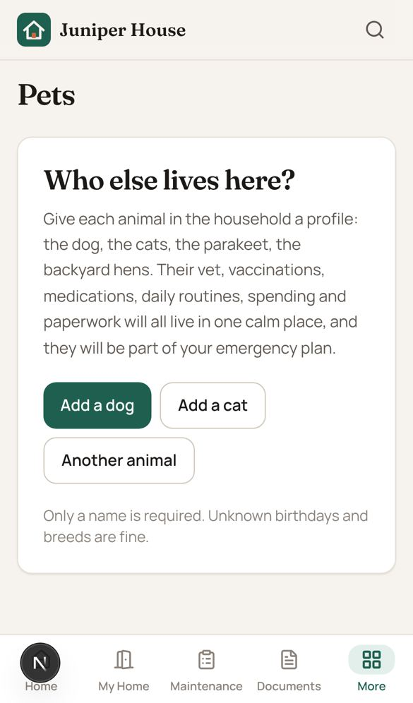 | 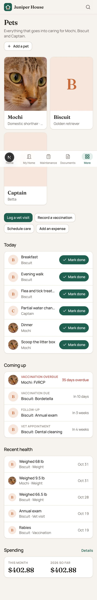 |
| 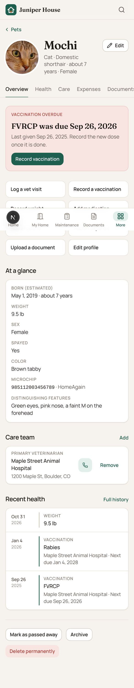 | 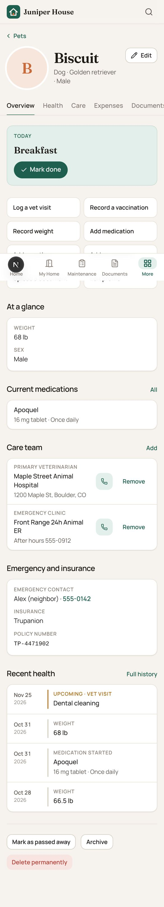 |
| 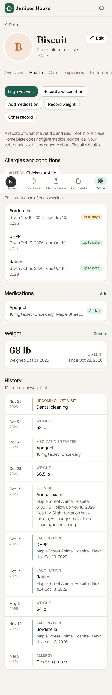 | 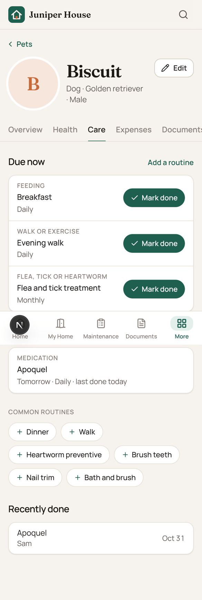 |
| 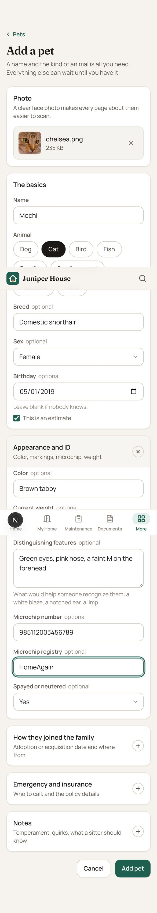 | 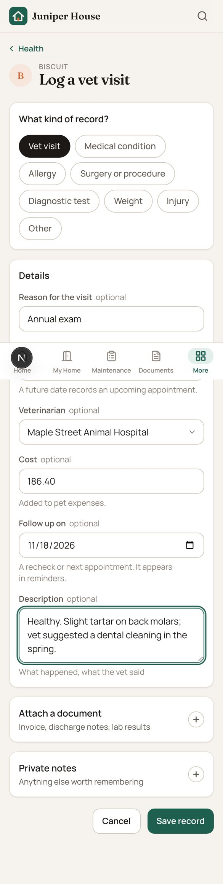 |
| 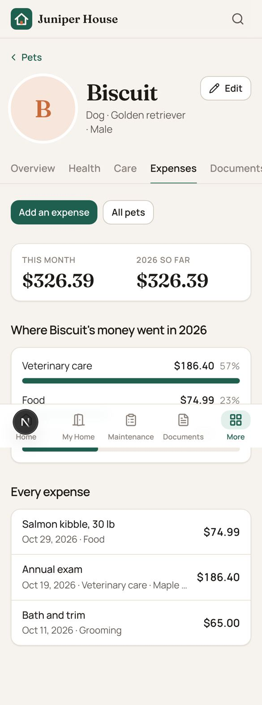 | 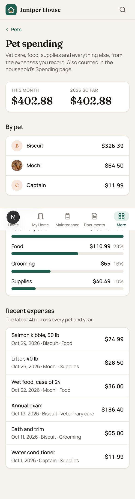 |
| 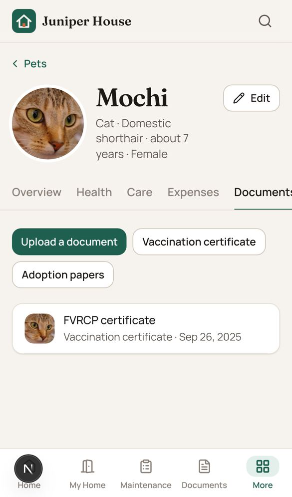 | 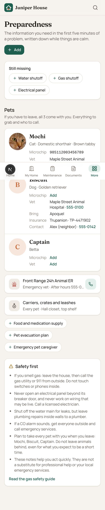 |
| 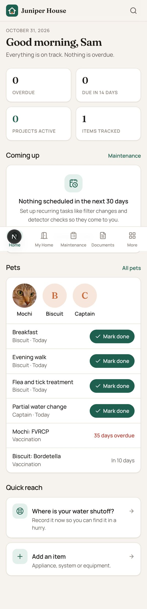 | 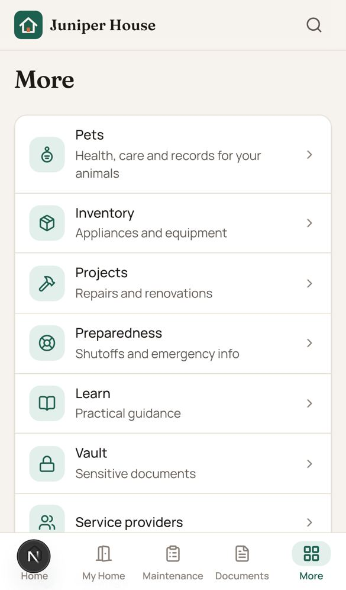 |

## Known limitations

- A routine is due once per day at most; "twice a day" is two routines
  (Breakfast, Dinner).
- Vaccine names are matched by name to find the latest dose ("Rabies" and
  "rabies" are the same vaccine; "Rabies 3-year" is a different one).
- Weight trend is the latest change, not a chart.
- Pets belong to the household's one property in the UI, like everything else.
